# Modelo de dados do VitrineIC — 3FN

Derivado do domínio real do sistema: `src/types/index.ts`, `server/schemas.ts`,
`server/database.ts`, `src/data/`. O banco atual guarda cada entidade como um
JSON em `data TEXT`; este documento abre esses JSONs em tabelas relacionais.

## Necessidades do sistema

**Identidade e acesso** — três papéis (estudante, solicitante, curadoria) numa
mesma tabela de conta; senha em hash scrypt; sessão por cookie com expiração;
token de recuperação e de confirmação de e-mail com validade e invalidação por
troca de credencial.

**Perfil do estudante** — vínculo com unidade e curso da UFAL; competências com
proficiência declarada; idiomas com proficiência; tópicos de interesse;
portfólio de projetos com pilha de tecnologias; anexos privados (comprovantes
e portfólio); selo "em projeto"; estado do onboarding.

**Perfil do solicitante** — organização, tipo (empresa, ONG, órgão público,
professor), cidade, site, descrição e pessoa responsável.

**Demanda** — publicada pelo solicitante, triada pela curadoria, com protocolo,
área, escopo, prazo, competências exigidas e trilha de mudanças de status.

**Match** — interesse único entre estudante e demanda, nascido de candidatura,
convite ou sugestão; resposta de cada lado; contato liberado só com aceite
duplo; motivo de recusa visível ao solicitante e à curadoria, nunca ao
estudante.

**Comunicação** — mensagens dentro de um interesse já liberado e notificações
por conta, com leitura.

**Catálogos** — unidades e cursos, competências com categoria e apelidos
(o match compara texto canonizado), idiomas, áreas, escopos, tópicos e as duas
escalas de proficiência.

**Impacto** — só o que não é derivável: depoimentos e metas. Os indicadores
continuam calculados em tempo de consulta sobre as tabelas abaixo.

## Decisões de normalização

1. **`estudante` não guarda `unidade`.** O curso determina a unidade, então
   manter os dois no estudante seria dependência transitiva. A unidade vem por
   `curso → unidade_academica`.
2. **`skills[]` + `skillLevels{}` viraram `estudante_competencia`.** Eram um
   grupo repetitivo mais um mapa paralelo que podiam divergir.
3. **Solicitante ganha chave substituta.** Hoje a PK é o nome da organização e
   as demandas referenciam esse texto: renomear quebra tudo.
4. **E-mail e nome da pessoa vivem só em `conta`.** Estavam duplicados em
   `Student.email` e `Company.contactEmail`/`contactName`.
5. **`initials` saiu** — é derivado do nome.
6. **Notificação não guarda mais o título da demanda nem o nome do remetente.**
   Dependiam de `demanda` e de `conta`, não da notificação.
7. **Mensagem foi separada de notificação.** Hoje as duas moram na mesma
   tabela distinguidas por `type`.
8. **Duas escalas de proficiência.** O nível 4 é "Especialista" em competência
   e "Fluente" em idioma: são tabelas distintas.
9. **`status` continua na demanda e no interesse** como estado corrente, com o
   histórico em tabela própria. É dependência funcional da chave, não redundância.

## Diagrama

```mermaid
erDiagram
    %% ───────────── Identidade e acesso ─────────────
    conta {
        uuid id PK
        varchar email UK "minúsculas, 254"
        varchar nome "pessoa responsável"
        varchar papel "student | requester | curator"
        text senha_hash "scrypt:salt:hash"
        integer versao_credencial "invalida tokens antigos"
        timestamp email_confirmado_em "nulo até confirmar posse"
        timestamp criada_em
    }
    sessao {
        char token_hash PK "sha-256 do cookie"
        uuid conta_id FK
        timestamp expira_em
    }
    token_conta {
        char token_hash PK
        uuid conta_id FK
        varchar proposito "reset_password | verify_email"
        integer versao_credencial
        timestamp criado_em
        timestamp expira_em
    }

    %% ───────────── Institucional ─────────────
    unidade_academica {
        varchar codigo PK "IC, CTEC, FAMED"
        varchar nome UK
    }
    curso {
        uuid id PK
        varchar unidade_codigo FK
        varchar nome "UK com unidade_codigo"
    }

    %% ───────────── Perfil do estudante ─────────────
    estudante {
        uuid id PK
        uuid conta_id FK,UK
        uuid curso_id FK "unidade vem daqui"
        varchar matricula
        varchar semestre
        numeric cra
        varchar bio "280"
        varchar github
        varchar linkedin
        varchar site
        varchar lattes
        varchar disponibilidade
        boolean em_projeto "selo mantido apos o contato"
        text foto "data-uri ou https"
        date onboarding_em
        boolean onboarding_pulado
    }
    estudante_competencia {
        uuid estudante_id PK,FK
        uuid competencia_id PK,FK
        smallint nivel FK "1..4"
    }
    estudante_idioma {
        uuid estudante_id PK,FK
        uuid idioma_id PK,FK
        smallint nivel FK "1..4"
    }
    estudante_topico {
        uuid estudante_id PK,FK
        uuid topico_id PK,FK
    }
    projeto_estudante {
        uuid id PK
        uuid estudante_id FK
        varchar titulo
        text descricao
        varchar situacao "ideation | coding | review | done"
        char ano "AAAA"
        uuid area_id FK
        varchar link
    }
    projeto_competencia {
        uuid projeto_id PK,FK
        uuid competencia_id PK,FK
    }
    anexo_estudante {
        uuid id PK
        uuid estudante_id FK
        varchar nome
        varchar categoria "tech | language | portfolio"
        varchar mime
        blob conteudo
        integer tamanho_bytes
        timestamp enviado_em
    }

    %% ───────────── Solicitante ─────────────
    tipo_solicitante {
        varchar codigo PK "empresa | ong | orgao_publico | professor"
        varchar rotulo
    }
    solicitante {
        uuid id PK
        uuid conta_id FK,UK
        varchar nome UK "organizacao"
        varchar tipo_codigo FK
        varchar rotulo_exibicao "ex.: Empresa de Tecnologia"
        varchar cidade
        char desde "AAAA"
        varchar site
        text descricao
    }

    %% ───────────── Demanda ─────────────
    demanda {
        uuid id PK
        varchar protocolo UK "VIC-AAAA-NNNN"
        uuid solicitante_id FK
        varchar titulo
        text descricao
        uuid area_id FK
        uuid escopo_id FK
        date prazo
        varchar status "nova | em_analise | aprovada | rejeitada | contato_liberado"
        varchar prioridade "alta | normal | baixa"
        varchar publico_alvo
        varchar nivel_academico
        varchar tamanho_equipe
        varchar orcamento
        text observacoes
        timestamp enviada_em
    }
    demanda_competencia {
        uuid demanda_id PK,FK
        uuid competencia_id PK,FK
    }
    demanda_historico_status {
        uuid id PK
        uuid demanda_id FK
        varchar status
        uuid alterado_por_conta_id FK "curadoria"
        text observacao
        timestamp alterado_em
    }

    %% ───────────── Match ─────────────
    interesse {
        uuid id PK
        uuid demanda_id FK
        uuid estudante_id FK "unico por demanda enquanto ativo"
        varchar origem "candidatura | convite | sugestao"
        text justificativa "obrigatoria na sugestao"
        varchar status "aguardando_estudante | aguardando_solicitante | contato_liberado | recusado_estudante | recusado_solicitante"
        uuid criado_por_conta_id FK
        timestamp criado_em
    }
    interesse_resposta {
        uuid interesse_id PK,FK
        varchar lado PK "estudante | solicitante"
        boolean aceito
        text motivo_recusa "nunca exposto ao estudante"
        timestamp respondido_em
    }

    %% ───────────── Comunicacao ─────────────
    mensagem {
        uuid id PK
        uuid interesse_id FK
        uuid remetente_conta_id FK
        text conteudo "5000"
        timestamp enviada_em
    }
    notificacao {
        uuid id PK
        uuid destinatario_conta_id FK
        varchar tipo "SISTEMA | MENSAGEM"
        uuid demanda_id FK
        uuid interesse_id FK
        uuid mensagem_id FK
        text conteudo "nulo quando vem de mensagem"
        timestamp criada_em
        timestamp lida_em "nulo = nao lida"
    }

    %% ───────────── Catalogos ─────────────
    categoria_competencia {
        uuid id PK
        varchar nome UK
    }
    competencia {
        uuid id PK
        varchar nome_canonico UK
        uuid categoria_id FK
        boolean fora_do_catalogo "declarada pelo estudante"
    }
    competencia_alias {
        uuid id PK
        uuid competencia_id FK
        varchar alias UK "ReactJS, react.js"
    }
    idioma {
        uuid id PK
        varchar nome UK
    }
    nivel_competencia {
        smallint nivel PK "1..4"
        varchar rotulo "Basico..Especialista"
    }
    nivel_idioma {
        smallint nivel PK "1..4"
        varchar rotulo "Basico..Fluente"
    }
    area {
        uuid id PK
        varchar nome UK
    }
    escopo_demanda {
        uuid id PK
        varchar rotulo UK "Pequeno, Medio, Grande"
        integer meses_max "ordenacao"
    }
    topico_interesse {
        uuid id PK
        varchar nome UK
    }

    %% ───────────── Impacto (nao derivavel) ─────────────
    depoimento {
        uuid id PK
        text texto
        varchar autor
        varchar papel_autor
        varchar periodo
    }
    meta_indicador {
        varchar chave PK
        varchar rotulo
        numeric valor_meta
        varchar periodo
    }

    %% ───────────── Relacoes ─────────────
    conta                 ||--o| estudante                : "perfil"
    conta                 ||--o| solicitante              : "perfil"
    conta                 ||--o{ sessao                   : "abre"
    conta                 ||--o{ token_conta              : "solicita"
    unidade_academica     ||--o{ curso                    : "oferta"
    curso                 ||--o{ estudante                : "matricula"
    estudante             ||--o{ estudante_competencia    : "declara"
    competencia           ||--o{ estudante_competencia    : "referida em"
    nivel_competencia     ||--o{ estudante_competencia    : "gradua"
    estudante             ||--o{ estudante_idioma         : "declara"
    idioma                ||--o{ estudante_idioma         : "referido em"
    nivel_idioma          ||--o{ estudante_idioma         : "gradua"
    estudante             ||--o{ estudante_topico         : "se interessa por"
    topico_interesse      ||--o{ estudante_topico         : "referido em"
    estudante             ||--o{ projeto_estudante        : "publica"
    area                  ||--o{ projeto_estudante        : "classifica"
    projeto_estudante     ||--o{ projeto_competencia      : "usa"
    competencia           ||--o{ projeto_competencia      : "referida em"
    estudante             ||--o{ anexo_estudante          : "envia"
    tipo_solicitante      ||--o{ solicitante              : "classifica"
    solicitante           ||--o{ demanda                  : "publica"
    area                  ||--o{ demanda                  : "classifica"
    escopo_demanda        ||--o{ demanda                  : "dimensiona"
    demanda               ||--o{ demanda_competencia      : "exige"
    competencia           ||--o{ demanda_competencia      : "referida em"
    demanda               ||--o{ demanda_historico_status : "registra"
    conta                 ||--o{ demanda_historico_status : "tria"
    demanda               ||--o{ interesse                : "recebe"
    estudante             ||--o{ interesse                : "manifesta"
    conta                 ||--o{ interesse                : "origina"
    interesse             ||--o{ interesse_resposta       : "coleta"
    interesse             ||--o{ mensagem                 : "comporta"
    conta                 ||--o{ mensagem                 : "envia"
    conta                 ||--o{ notificacao              : "recebe"
    demanda               ||--o{ notificacao              : "contextualiza"
    interesse             ||--o{ notificacao              : "contextualiza"
    mensagem              ||--o| notificacao              : "entrega"
    categoria_competencia ||--o{ competencia              : "agrupa"
    competencia           ||--o{ competencia_alias        : "conhecida como"
```

## Restrições que o diagrama não expressa

- `interesse`: índice único parcial em `(demanda_id, estudante_id)` enquanto o
  status não for `recusado_estudante` nem `recusado_solicitante` — recusa
  permite nova tentativa.
- `estudante.conta_id` e `solicitante.conta_id` são `UNIQUE`; o papel da conta
  tem de combinar com a tabela de perfil.
- `curso`: `UNIQUE (unidade_codigo, nome)`.
- `token_conta`: `UNIQUE (conta_id, proposito)` — um link vivo por finalidade.
- `demanda.status` só vai a `contato_liberado` por consequência de um
  interesse liberado.
- `interesse.status` é derivável de `interesse_resposta`; mantê-lo exige
  gatilho ou escrita na mesma transação.
- Perfil sem nenhuma competência não aparece na vitrine (`isProfileVisible`):
  é regra de consulta, não restrição de tabela.
- Indicadores do painel de impacto são calculados por consulta. Não crie
  colunas para eles.
